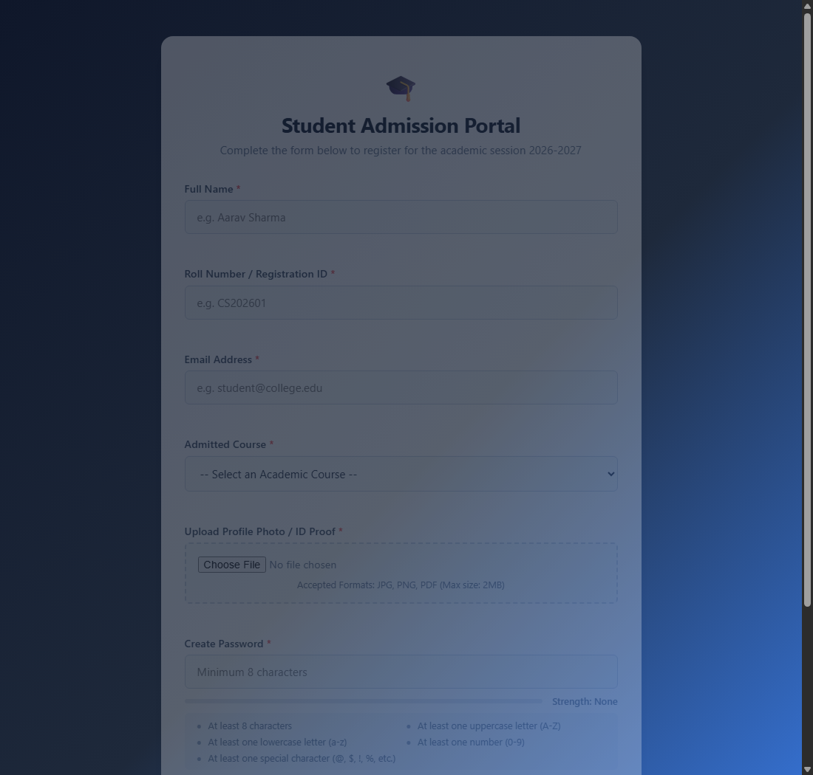
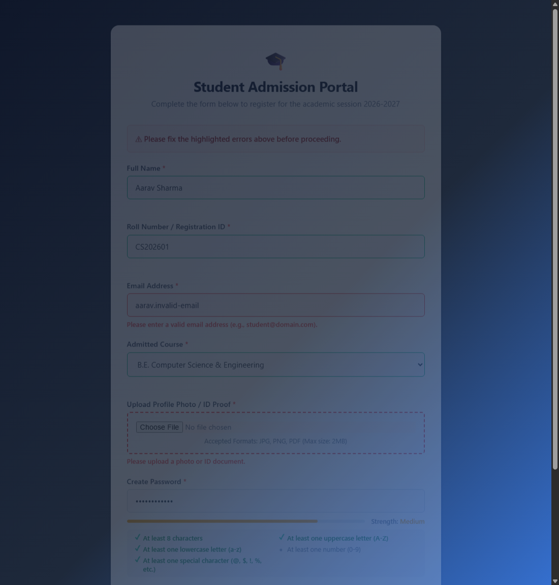
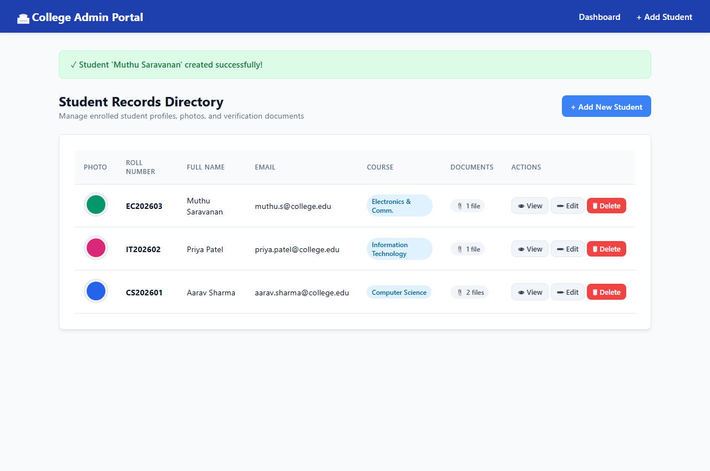
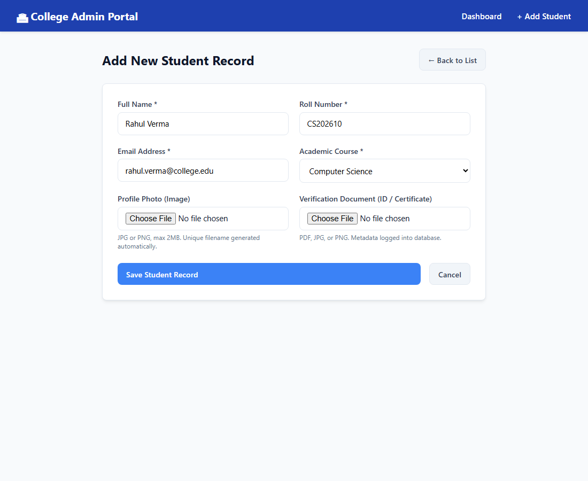
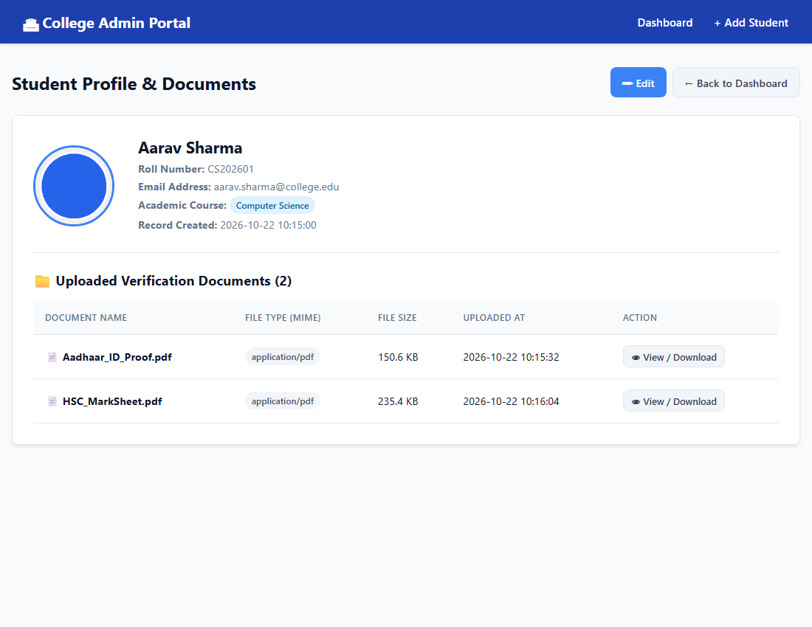
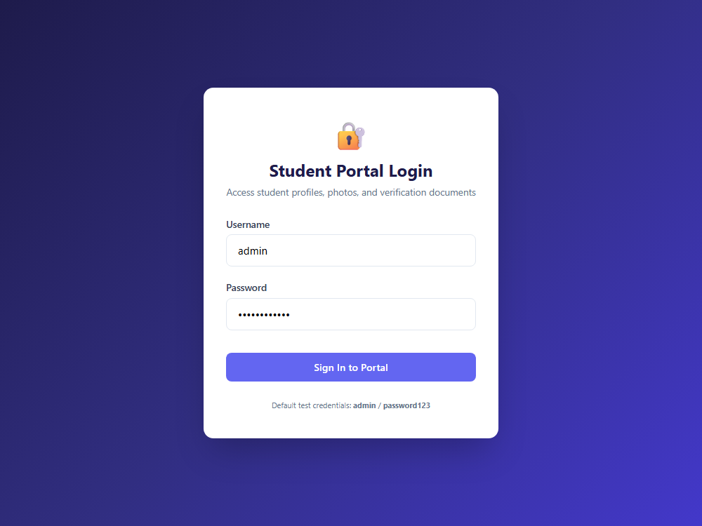
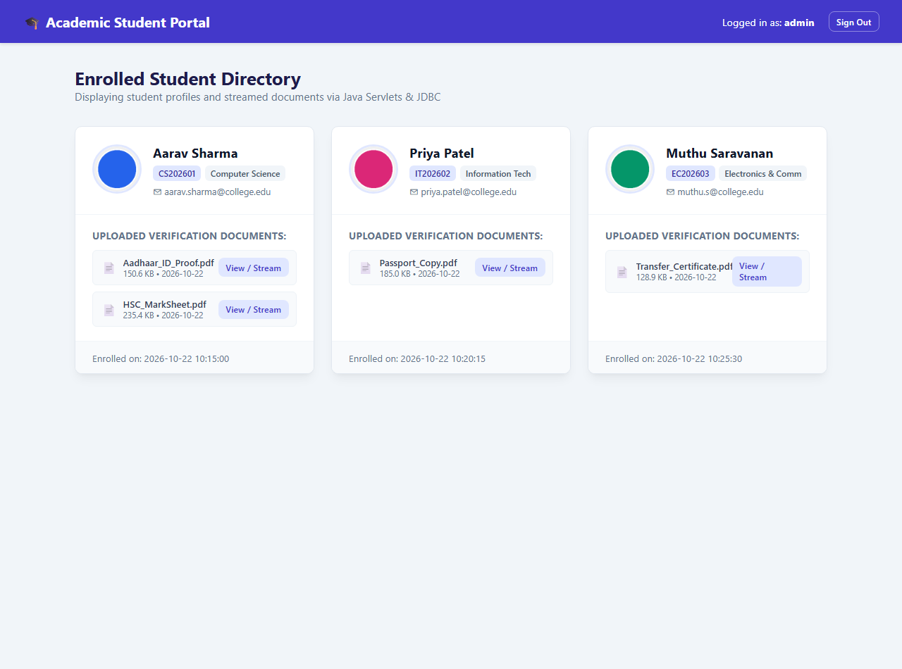

# Web Technology Assignment 2 - Output Screenshots

This document aggregates browser output screenshots for all three questions in the assignment.
The raw screenshot image files are located in the [`screenshots/`](screenshots/) directory.

---

## Question 1: Student Admission Registration Form (HTML, CSS, JS)

### 1. Initial Registration Form State
Clean, responsive layout styled with modern CSS variables, card container, styled inputs, and password strength requirements checklist.

---

### 2. Client-Side Validation & Dynamic Password Strength
Demonstrates real-time JavaScript validation: required fields check, email format regex validation, file type/size validation, and dynamic password strength evaluation (Medium strength bar with satisfied checklist items).

---

## Question 2: College Admin Panel (PHP + MySQL CRUD & File Uploads)

### 3. Admin Dashboard & Student Directory
Displays student records fetched from MySQL using PDO, profile photos, course badges, uploaded document count, and CRUD action triggers (View, Edit, Delete).

---

### 4. Add Student Form with File & Document Upload
Allows administrators to add student records, upload a profile photo (JPG/PNG), and attach verification documents (PDF/ID proof) with automatic unique file renaming to prevent overwriting.

---

### 5. View Student Details & Uploaded Documents Metadata
Displays complete student profile details and an interactive table of all attached documents with their metadata (File Name, MIME Type, File Size in KB, and Upload Date) along with view/download links.

---

## Question 3: Front-End Student Portal (Java Servlets, JSP & JDBC)

### 6. Portal Secure Login (Session Authentication)
Secure gateway requiring authentication against MySQL `users` table before establishing an `HttpSession`.

---

### 7. Student Profiles Dynamic Portal (Image Streaming & Looping)
Displays student cards inside `portal.jsp` using dynamic Java scriptlet looping and conditional logic. Student profile photos are streamed directly through `FileStreamServlet` (``), and verification documents are listed with direct streaming links.

